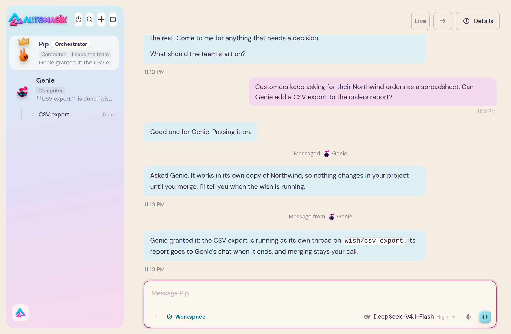

<p align="center"></p>

<h1 align="center">Automagik</h1>

<p align="center"><b>A team of AI helpers that lives in your chats.</b></p>

<p align="center">Automagik is superintelligence, in open building blocks: a team of AI agents in your chats,<br>
and each part usable on its own once it ships; Cloud is still in design.</p>

<p align="center">
  <a href="https://automagik.si/#film"></a>
</p>

<p align="center"><b>The film: our own GTM team.</b> The team launching Automagik, at work. Music only, no voice-over.<br>
<a href="https://automagik.si/#film">Watch the film on automagik.si</a></p>

<p align="center">
  <a href="https://github.com/automagik-si/automagik/releases/latest/download/Automagik-Mac.dmg"><b>⬇ Download for Mac</b></a>
  &nbsp;·&nbsp;
  <a href="https://github.com/automagik-si/automagik/releases/latest/download/Automagik-Linux.deb"><b>⬇ Download for Linux</b></a>
</p>

<p align="center">Cloud is coming; no date yet. <a href="https://automagik.si">Join the Cloud waitlist on automagik.si</a></p>

<p align="center"><sub>This repository, <a href="https://github.com/automagik-si/genie">Genie</a> and <a href="https://github.com/automagik-si/omni">Omni</a> are free and open source, Apache-2.0. Cloud is a private, paid service.<br>
Mac with Apple silicon, macOS 13 or newer · Linux on a 64-bit PC · Windows is not supported yet</sub></p>

---

## Two modes

**Team mode** is the desktop app: a team of long-lived Bots, each with its own name, role, model and memory. They talk to you, to each other and in group chats, run scheduled tasks, and each drives a browser of its own. With an [Omni](https://github.com/automagik-si/omni) connected, your WhatsApp, Telegram, Slack and other channels sit in the same window, and the Bot you put on a chat acts when something happens there. The team runs on [DeepSeek Harness](https://github.com/deepseek-ai/deepseek-harness) (DSH).

**Code mode** is your code agents in the real [Herdr](https://herdr.dev) window, with the Automagik pack: a sidebar of spaces, Bots and workers across coding harnesses. Nothing in Herdr is rebuilt. The app's switch brings the Herdr window forward on the space for the current Bot's folder, and a button in Herdr brings you back. The app download alone does not set Code mode up: it needs Herdr and the pack, and [the pack's installer](herdr/README.md#install) sets up both.

<sub>Team mode: the app's switch still says Work.</sub>

## The seven blocks

Each block is usable alone.

- **[Team mode (DSH)](apps/bots-dsh/README.md)**: the Bot team on DeepSeek Harness: long-lived Bots with their own name, role, model and memory, group chats, schedules and the Bot browser.
- **[Code mode (Herdr)](herdr/README.md)**: your code agents in the real Herdr window with the Automagik pack; nothing in Herdr is rebuilt.
- **[Genie](https://github.com/automagik-si/genie)**: a wish becomes a branch, a test run and a report you approve; `genie desktop` opens it on the team.
- **[Omni](https://github.com/automagik-si/omni)**: the service that links your chat apps to Automagik, with its channels and canvases in the same window.
- **[Pocket](apps/pocket/README.md)**: your coding agents on your Android phone, paired to your own machines.
- **[The meter](meter/usagemeter/README.md)**: usagemeter, the Rust token meter that records usage and cost on the machine and answers `usagemeter query`.
- **[Cloud](docs/rfcs/0024-automagik-cloud.md)**: one sign-in, organisations and hosted workspaces, with a rail that opens each.

<sub>Cloud is designed and accepted, and is not live. When it ships it is a private, paid hosted service: not free and not open source. Only its contracts are public (<a href="docs/rfcs/0024-automagik-cloud.md">RFC 0024</a>).</sub>

## What makes it yours

- **Your model.** Connect the AI account you already have, or an API key from a provider you use. Each Bot runs on the model you give it.
- **Your files and memory, on your computer.** What the team keeps is in one folder, `.automagik` in your home folder. Each Bot keeps notes across its conversations, each group chat keeps its own, and the team shares one more. Your chats stay in your Omni. What your Bots read and write goes to the AI account you connected, under that company's terms.
- **Secrets the Bots never see.** When a Bot needs an API key, a token or a password, it asks with a card in its own chat. You type the value; the Bot never sees it.
- **It asks before it acts as you.** Before a Bot sends a message as you to a person, deletes something or disconnects a channel, it shows you exactly what it will do and asks first. The exceptions: your Main Bot and an Omni Bot read your chats and post to a group, a WhatsApp channel or your own chat with yourself without asking. Any other Bot reads and posts only where you allow: the first time it wants a chat it asks, and you answer **Once**, **Always** or **No**; after **Always** it posts to that group without asking again.

## Install

The current release is always at [Releases](https://github.com/automagik-si/automagik/releases/latest).

**Mac** (Apple silicon, macOS 13 or newer):

1. [Download Automagik for Mac](https://github.com/automagik-si/automagik/releases/latest/download/Automagik-Mac.dmg).
2. Open **Automagik-Mac.dmg** and drag the Automagik icon onto the Applications folder.
3. Open **Automagik** from Applications.

**Linux** (64-bit PC):

1. [Download Automagik for Linux (.deb)](https://github.com/automagik-si/automagik/releases/latest/download/Automagik-Linux.deb) for Ubuntu or Debian.
2. Double-click it and choose **Install**, or run `sudo apt install ./Automagik-Linux.deb`.
3. Open **Automagik** from your apps.

On another Linux, use the [AppImage](https://github.com/automagik-si/automagik/releases/latest/download/Automagik-Linux.AppImage). Windows is not supported yet.

The app has two things to connect when you are ready: an Omni and an AI account. Both can wait. The full guide, updates, your data and uninstall are in [apps/desktop](apps/desktop/README.md). Code mode installs separately: [herdr](herdr/README.md#install). Pocket: [apps/pocket](apps/pocket/README.md#install).

**For your code agent**: `npx skills add automagik-si/automagik --skill am` adds the skill that teaches it `am`, Automagik's one command.

## This repository

Automagik's plugins for [DeepSeek Harness](https://github.com/deepseek-ai/deepseek-harness) (DSH), and the Automagik desktop app that runs them, with the Herdr pack (`herdr/`), Pocket (`apps/pocket/`) and the meter (`meter/`).

| Folder | Package | What it is |
|---|---|---|
| [`apps/bots-dsh`](apps/bots-dsh/README.md) | `@automagik/bots-dsh` | The Bot team: long-lived Bots, group chats, memory, settings, scheduled tasks, the Bot browser. Omni's and Genie's plugins build on it. |
| [`apps/welcome-dsh`](apps/welcome-dsh/README.md) | `@automagik/welcome-dsh` | The welcome: the octopus, the team step, and Connect AI through DSH's own sign-ins. |
| [`apps/acp-dsh`](apps/acp-dsh/README.md) | `@automagik/acp-dsh` | Agents other than DSH's own, over ACP (Agent Client Protocol), as DSH models: the agent's tool calls show as DSH tool cards and ask through DSH's approval dialog (RFC 0003). |
| [`apps/locale-pt-br-dsh`](apps/locale-pt-br-dsh/README.md) | `@automagik/locale-pt-br-dsh` | Português: the Bot team's Brazilian Portuguese under DSH's own Portuguese entry. Adds no language of its own, so Settings › General › Language keeps one Portuguese row; a pt-BR choice saved by an older pack moves to DSH's pt. |
| [`apps/desktop`](apps/desktop/README.md) | (the app) | The Automagik desktop app: DSH of its own with the Bot team, the welcome and Omni's channels and canvases. `omni desktop` opens it with Omni preloaded, `genie desktop` with Genie. |

Omni's own plugins (its channels and canvases) live with Omni, in [automagik-si/omni](https://github.com/automagik-si/omni) (`apps/omni-channels-dsh`, `apps/omni-canvas-dsh`), and carry Omni's version.

### Install into your own DSH

- **The desktop app**: download it from [Releases](https://github.com/automagik-si/automagik/releases/latest), or run `omni desktop`. See [apps/desktop](apps/desktop/README.md).
- **Into your own DSH**: add the Automagik market to DSH's plugin market and install from there:

  ```
  https://raw.githubusercontent.com/automagik-si/dsh-marketplace/main/index.json
  ```

  Every Omni also serves a market at `https://<your-omni>/api/market/index.json` with the release of these plugins it was tested with.

Nothing here is published to npm. The plugins install as git sources pinned to a release commit, or from the tarballs each release carries (`plugins.json` lists their integrity).

### History

`@automagik/bots-dsh` and `@automagik/welcome-dsh` were `@automagik/omni-dsh` and `@automagik/omni-ai-dsh` in automagik-dev/omni (`apps/omni-ui-dsh`, `apps/omni-ai-dsh`), and the desktop app was automagik-dev/omni-desktop. They moved here with their history. What did not change with the names: plugin ids (`omni-ui`, `omni-ai`), routes and browser-storage prefixes. From 3.12 the team's home is Automagik's own (`~/.automagik/bots`, or `~/.automagik/desktop/bots` in the app), and the app's identity is Automagik's (`ai.namastex.automagik`): an app from 3.11.x or before is installed afresh, not updated.

- The Bot team's client bundle also answers to its former name, so channels and canvas plugins built before the rename keep working on it.
- In your own DSH: install `@automagik/bots-dsh` from the market. With both installed, the newer one runs (they share the plugin id); remove `@automagik/omni-dsh` when you like. A settings row in your profile's `cordis.patch.yml` that names `@automagik/omni-dsh` needs its `name:` changed to `@automagik/bots-dsh` to keep applying.

### Versions and releases

One version for the whole repository, `3.N` (semver `3.N.0`, N one above the last release: `scripts/version.ts`), above the 2.x builds omni-desktop released. Every merge into dev is a release: `release.yml` tags `v<version>`, publishes the plugin tarballs and `plugins.json`, builds the desktop app into the same release (`desktop-build.yml`), lists the release in [`marketplace/automagik.json`](marketplace/automagik.json), and moves `main` to it. `follow-omni.yml` moves the desktop app to each newer Omni release and cuts a release with it.

| Branch | What |
|---|---|
| `dev` | Integration: pull requests land here; releases are cut from it |
| `main` | The latest release, moved by `release.yml` only |

### Develop

Bun for the repository's own tooling; the plugins run on Node, as DSH does (`node --test`, esbuild), with Bun installing them; the desktop app uses npm for Electron.

```sh
bun install && bun run check                    # versions, release tooling, market index
cd apps/bots-dsh && bun install && bun run harness && bun run test
cd apps/welcome-dsh && bun install && bun run harness && bun run test
cd apps/desktop && npm ci && npm test
node scripts/boot-check.mjs                     # boot the plugins with Omni's in headless Chromium
```

### License

This repository is Apache-2.0. See [LICENSE](LICENSE) and [NOTICE](NOTICE). [Genie](https://github.com/automagik-si/genie) and [Omni](https://github.com/automagik-si/omni) are Apache-2.0 in their own repositories. Automagik Cloud is not part of this licence: it is a private, paid service.
