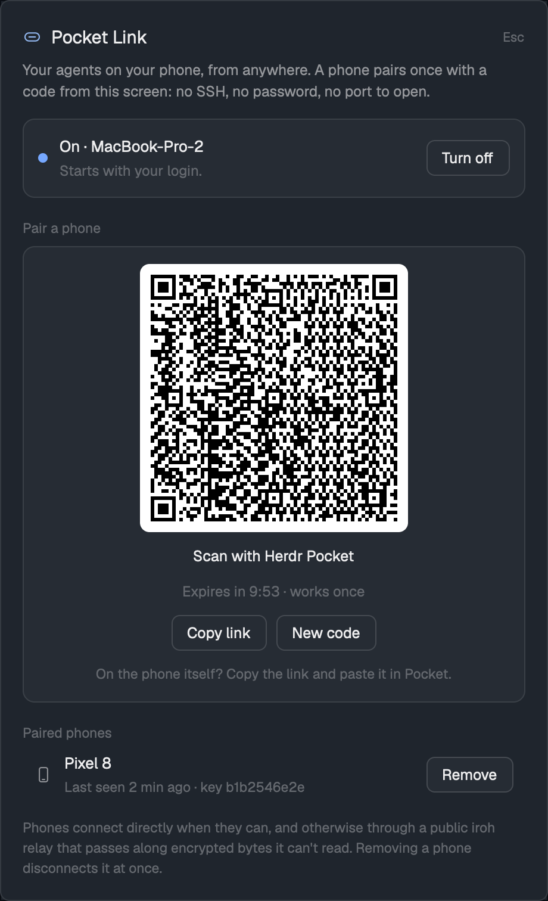

# Pocket Link for Herdr

Pair your phone with Herdr desktop like a TV pairs with a streaming account:
press **Pair a phone**, scan the code with [Automagik Pocket](https://github.com/automagik-dev/automagik-pocket),
done. Your agents on your phone from anywhere, with no SSH, no password and no port to open.



## Install

Ask your Herdr agent to add this mod, or do it yourself:

1. Copy `mods/pocket-link/` into `~/.config/herdr-app/mods/`.
2. Merge `keys.json` into `~/.config/herdr-app/keys.json` (⌘⌥P on macOS, Ctrl+Alt+P on Linux).
3. Open it with ⌘⌥P. The first time, press **Install the bridge** (npm, about 25 MB), then **Turn on**.

It needs Node.js 20.3+ and herdr-core (`hc`), on macOS or Linux (systemd). Herdr opened from the
Dock doesn't see a Node that only your shell's rc file adds to PATH, so the dialog also looks in
your login shell, nvm, volta, fnm, asdf and Homebrew ([RECIPE.md](RECIPE.md#how-it-behaves)).

## Update

No release ships the mod and nothing updates an installed copy. To update it:

1. Press **Turn off** in the dialog. The bridge loads its packages even to stop, so do this before
   anything changes.
2. Copy the new `mods/pocket-link/` over the old one from a fresh clone:

   ```sh
   d=$(mktemp -d) && git clone -q --depth 1 https://github.com/automagik-dev/automagik-pocket "$d" && rsync -a "$d/desktop/pocket-link/mods/pocket-link/" ~/.config/herdr-app/mods/pocket-link/
   ```

   `rsync` without `--delete` keeps `bridge/node_modules`.
3. If the update changed `bridge/package-lock.json`, delete `bridge/node_modules` and press
   **Install the bridge** when the dialog asks.
4. Press **Turn on**.

Pairings live outside the mod folder and stay.

## What it does on your computer

- Runs a small bridge (`mods/pocket-link/bridge/bridge.mjs`) as a login service:
  a LaunchAgent on macOS, or a systemd user unit on Linux.
- **Network:** [iroh](https://iroh.computer). Phones dial this computer by its public key.
  Connections are direct when they can be, otherwise through n0's public relays,
  and always end to end encrypted. The bridge also publishes its address to n0's lookup service.
- **Programs it runs:** `node`, `npm` (setup), `hc connect`, `launchctl` / `systemctl --user`, `sh`,
  `ls`, and your login shell, once, to find `node`.
- **Files it writes:** its state folder (below), the one login service file, and `.node` in the
  mod folder (the path of the Node it runs with).
- **Where its state lives:** `${XDG_STATE_HOME:-~/.local/state}/automagik-pocket-link/`, mode 0700,
  outside the mod folder: this computer's key (`secret.key`, the identity phones pair with), the
  paired phones, the current pairing code, the bridge's address and its log (`bridge.log`, and
  `bridge.log.1` once it has filled), each 0600; and `public-status.json` (0644), which says only whether phones are connected
  ([For other mods](#for-other-mods)).
  - **Reinstalling the mod is safe.** Deleting `mods/pocket-link/` and copying it again keeps every
    pairing; only **Install the bridge** (npm) needs pressing again.
  - Older versions kept it in `mods/pocket-link/.state/`. The first time the new bridge runs, it
    moves those files over and leaves `.state/` empty.
  - A Herdr started with another `HERDR_APP_HOME` gets its own folder,
    `automagik-pocket-link-<hash>/`, so a test window never sees your phones.
    `POCKET_LINK_STATE_DIR` sets the folder outright; the login service is given it.
  - Deleting this folder unpairs every phone.

- **Before a phone is paired** (`bridge/guard.mjs`, `bridge/pairing.mjs`):
  - A connection from a source address that isn't validated yet gets a QUIC retry first, so a
    spoofed address never takes a slot.
  - A connection gets 10 seconds for its handshake and first line, and a pairing all of it, then
    it is closed. At most 16 connections can be in that phase, 4 of them from one address (an IPv4
    address, an IPv6 /64, or over a relay the key it claims), and 64 open in all; past that, new
    ones are refused before their handshake.
  - A key that isn't paired is closed before the bridge reads anything from it, and so is a
    pairing attempt while no code is live.
  - One phone key gets 3 wrong codes, then its tries are refused without counting. Only a flood
    (1000 wrong codes in all) ends a code: new keys are free, so a low total would let one stranger
    end each new code. Codes are 128-bit, so guessing isn't the worry.
  - Closing the dialog ends its code (`bridge.mjs cancel`). Each paired phone shows its key's
    fingerprint, the first 12 hex characters in fours, next to the name the phone sent.
  - Refusals, timeouts and wrong codes log at most 5 lines of each kind a minute. `bridge.log`
    stays under 1 MB: past that it is copied to `bridge.log.1` and emptied.
  - **What's left (accepted):** someone who knows this computer's key can still fill the 16
    pending slots, by flooding through a relay with a new key per connection or by stalling
    handshakes. While that lasts, a paired phone's *new* sessions are refused. Sessions already
    open keep working, and nothing gets paired. The remedy is a new desktop key, so the old address
    leads nowhere: [#48](https://github.com/automagik-dev/automagik-pocket/issues/48).
- **No usage meter.** Older versions installed and ran
  [usagemeter](https://github.com/automagik-dev/usagemeter) on every connected machine. The
  Automagik Herdr pack installs it now; the phone only reads its summary
  ([decision](../../docs/decisions/pocket-link-no-meter-installer.md)).

A paired phone can use every herdr-core session on this computer, just like a terminal running `hc`.
Pair only your own phones. Remove one in the dialog and it's disconnected at once.

## For other mods

Another mod (a sidebar dot, say) can tell whether a phone is connected from `public-status.json`
in the state folder. It is **read-only for other mods**: only the bridge writes it, and no other
file in the folder is part of this contract.

**Where it is.** The first that applies, as `bridge/state.mjs` (`stateDir`) resolves it:

1. `$POCKET_LINK_STATE_DIR`, when set to an absolute path.
2. `${XDG_STATE_HOME:-~/.local/state}/automagik-pocket-link-<hash>/`, when `HERDR_APP_HOME` is set
   to an absolute path other than `~/.config/herdr-app`. `<hash>` is the first 8 hex characters of
   the SHA-256 of the resolved `HERDR_APP_HOME` path.
3. `${XDG_STATE_HOME:-~/.local/state}/automagik-pocket-link/`.

A relative `XDG_STATE_HOME` or `HERDR_APP_HOME` is ignored. The folder is 0700, so only your own
user can read the file.

**What it holds** (schema 1):

```json
{
  "schema": 1,
  "running": true,
  "updated": 1793520000000,
  "phones_connected": 1,
  "phones": [{ "name": "Pixel 9", "since": 1793519400000 }]
}
```

- `schema`: 1. A new field can be added within schema 1, so ignore fields you don't know. Removing
  or renaming a field, or changing its type or meaning, takes a new number: treat any value but 1
  as unknown.
- `running`: the bridge is serving. A clean stop (**Turn off**, `bridge.mjs stop`, logout) writes
  `false`, with no phones.
- `updated`: when it was written, in epoch milliseconds. While it runs, the bridge rewrites it at
  least every 30 seconds (every 20 today) and whenever a phone connects or hangs up.
- `phones_connected`: how many phones have a session open now. A phone with several sessions open
  counts once.
- `phones`: one entry per connected phone, oldest first: `name`, the device name the phone sent
  when it paired, and `since`, when its oldest open session began (epoch ms).

**Staleness.** If `updated` is more than 90 seconds old, the bridge stopped without saying so
(killed, or the computer slept): treat it as `running: false` with no phones. Treat a missing or
unreadable file, or another `schema`, the same way.

It never holds the pairing ticket, this computer's endpoint id, a phone's key or any secret. Those
stay in `status.json` and the other 0600 files, which other mods must not read.

See [RECIPE.md](RECIPE.md) for how it's built.

## License

Apache-2.0
